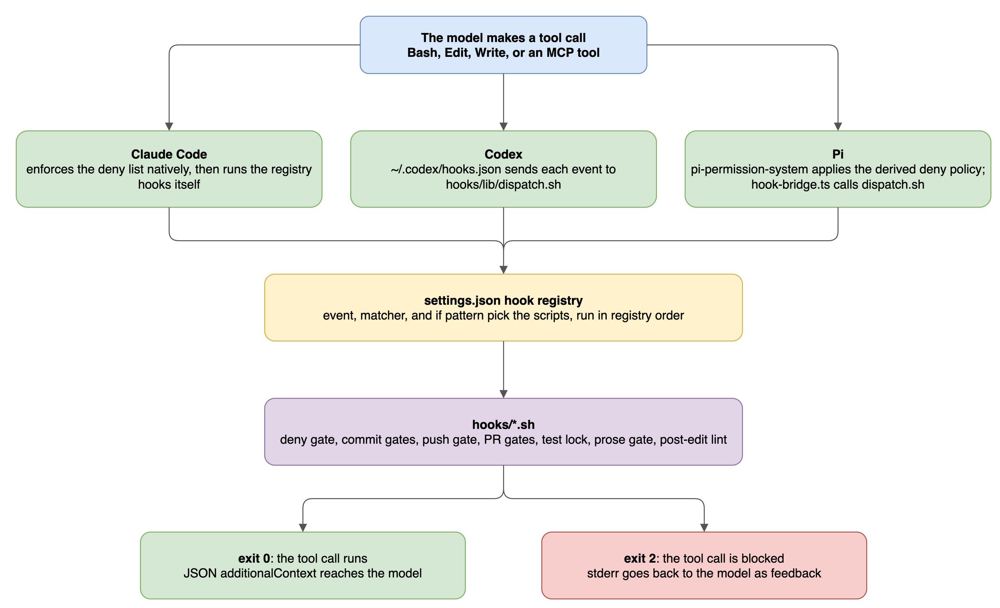

# Hooks and the deny list

`settings.json` holds one hook registry and one deny list for every host. Claude Code runs the registry itself; Codex and Pi run the same scripts through `hooks/lib/dispatch.sh`. A hook that exits 2 blocks the tool call, and its message goes back to the model. A Bash hook registered under several `if` rules, before or after the call, runs once per tool call, because `hooks/lib/once.sh` lets only the first matching run do the work.

## Why hooks

An agent can forget an instruction. It cannot skip a hook, because the host runs the hook before or after the tool call, outside the model. A rule that a script can check therefore lives in `hooks/` and carries the `(hook)` tag, as [rules](rules.md#enforcement-tags) describes.

## How a hook runs

*Source: [`hook-dispatch.drawio`](diagrams/hook-dispatch.drawio)*

The diagram follows one tool call. Each host passes it to the same registry, the registry picks the matching scripts, and each script's exit code decides the outcome.

A registry entry has four parts:

| Part | Meaning | Example |
| --- | --- | --- |
| Event | When the hook runs | `PreToolUse`, `PostToolUse`, `SessionStart` |
| `matcher` | A regex on the tool name, or on the session source | `Bash`, `Write\|Edit` |
| `if` | An optional glob on the tool input | `Bash(git commit *)` |
| `command` | The script and its arguments, with a timeout | `hooks/prose-gate.sh commit` |

Each command runs `~/.claude/hooks/<name>`, which links to the main checkout. No command runs a project's own `hooks/` copy, so an opened repo cannot replace a gate, and an agent worktree runs the main checkout's hooks rather than its branch copy. A hook edit therefore takes effect only once it reaches the main checkout. Verify it before then with its `tests/*.sh` suite or `npm test`, not in a live session.

Hooks still read `CLAUDE_PROJECT_DIR` for the project they inspect. On Codex and Pi, `dispatch.sh` sets it to the git top level of the working directory. On Claude Code, it is the directory the session started in, which is not always the git root.

Exit codes decide the outcome:

- **0** lets the tool call run. JSON output with `additionalContext` adds text for the model.
- **2** blocks a `PreToolUse` call, and the script's stderr reaches the model as feedback. A `PostToolUse` hook runs after the file is saved, so its exit 2 sends the feedback without undoing the edit.
- Any other code lets the call run. Claude Code shows a non-blocking error, and `dispatch.sh` ignores the code, so a broken hook fails open on every host.
- A hook that runs past its `timeout` lets the call run on every host. Claude Code cancels it after 10 minutes when unset, as the [hooks reference](https://code.claude.com/docs/en/hooks) describes, unless the entry sets `onFailure: "block"`. No entry here does. `dispatch.sh` kills it after 60 seconds when unset.

### Naming

A tool hook is named `<event>-<concern>.sh`. The event part says when it runs and on what: `pre-commit`, `pre-push`, `pre-pr`, `pre-edit`, `pre-git`, `post-edit`, `post-pr`, `post-verify`. The concern part says what it checks, and ends in `-gate` when the hook can block, as in `pre-commit-msg-gate.sh`. One hook covers one concern on one event, so two checks of the same text share a hook rather than a prefix. Session hooks and hooks that serve several events, such as `prose-gate.sh`, `deny-gate.sh`, and `symlink-check.sh`, keep a concern-only name. Hooks stay flat in `hooks/`, and shared code goes in `hooks/lib/`.

## Host coverage

| Host | Tool hooks | Session hooks | Deny list |
| --- | --- | --- | --- |
| Claude Code | Native, from `settings.json` | Native: `SessionStart`, `SessionEnd`, `CwdChanged`, `Stop`, `Notification` | Native `permissions.deny`, plus `deny-gate.sh` |
| Codex | `~/.codex/hooks.json` calls `dispatch.sh` | `SessionStart` and `SessionEnd` through `dispatch.sh`; no `Notification` | `deny-gate.sh`, including the `Bash` rules |
| Pi | The `hook-bridge` extension calls `dispatch.sh` for `bash`, `edit`, and `write` | `SessionStart` and `SessionEnd` through `hook-bridge`, except on a reload or in a subagent; the `drift-check` extension at start | The `permission-gate` extension derives a policy for the pinned `pi-permission-system` package; `deny-gate.sh` runs through the bridge |

`dispatch.sh` makes one registry serve three hosts. It reads `settings.json` from the checkout on every call, so a registry edit reaches Codex and Pi at once. It maps each host's tool names to Claude Code's, so Codex shell tools become `Bash` and each file in an `apply_patch` becomes an `Edit`. It runs the matching hooks in registry order, stops at the first exit 2, and merges the context the others print. Each hook runs from the dispatcher's own `hooks/`, never from the project's. A command that several matching rules name runs once per call.

The dispatcher sets `AGENT_HOOK_HOST` to `codex` or `pi`, and Claude Code leaves it unset. A registry command that tests `[ -z "$AGENT_HOOK_HOST" ]` runs on Claude Code only. Pi maps a session start to the `startup`, `resume` (also a fork), or `clear` (a new session) source. On Pi, `SessionStart` output appears as a notice, not as model context. Pi awaits `SessionEnd` before it exits, and reports its failures on stderr.

## PreToolUse hooks

These run before the tool call and can block it. The rows follow registry order. `dispatch.sh` runs them in that order, and Claude Code runs them in parallel on the original input.

| Hook | Runs on | Blocks when | Bypass |
| --- | --- | --- | --- |
| `deny-gate.sh` | Bash, Write, Edit, MCP tools | A command names a denied path, an edit targets one, or an MCP tool is denied. It applies `Bash` rules on every host, after normalizing each segment, as [the deny list](#the-deny-list) describes | None |
| `pre-outbound-email-scrub.sh` | WebFetch URLs, WebSearch queries, and Bash commands that name a URL or a network client such as `curl`, `wget`, or `gh` | Codex and Pi: the call carries an email address. Claude Code never blocks: it returns `updatedInput` with each address replaced by `redacted@example.invalid`. Noreply addresses, example domains, `git@host:` remotes, the login of the requested URL unless curl sends the request through a proxy, `--connect-to`, or `--resolve`, ssh-family targets, and local git steps without a URL or a server subcommand such as `push` pass. A literal `curl -u <email>:<token>` is scrubbed, so pass that login through a variable | `SKIP_EMAIL_SCRUB` |
| `pre-git-state-refresh.sh` | `git push` and `git commit`, also through `git -C <dir>`, and `gh pr` `edit`, `comment`, `merge`, `close`, `ready`, `review`; not `gh pr create` | Never. It adds a `[pr-state]` line with the branch's PR state | `SKIP_PR_STATE_REFRESH` |
| `pre-pr-test-gate.sh` | `gh pr create`, `gh pr ready` | The title is not conventional, or HEAD has no passing verify run | `SKIP_PR_TEST_GATE` |
| `pre-pr-evidence-gate.sh` | `gh pr create`, when a spec names the branch | A non-manual acceptance criterion lacks a PASS row at HEAD | `SKIP_EVIDENCE_GATE` |
| `pre-push-gate.sh` | `git push`, including `git -C <dir> push` | The branch's PR already merged, a repo check fails, the package manager or `node_modules` is missing, or `core.hooksPath` names a missing dir. See below | `SKIP_PUSH_GATE` |
| `pre-commit-branch-gate.sh` | `git commit`, including `git -C <dir> commit` | The branch is `main` or `master` | `SKIP_COMMIT_BRANCH_GATE` |
| `pre-commit-msg-gate.sh` | `git commit`, including `git -C <dir> commit` | The command contains a `Co-authored-by` trailer, or the subject is not a conventional commit | `SKIP_COAUTHOR_GATE` for the trailer, `SKIP_CONVENTIONAL_GATE` for the subject |
| `prose-gate.sh` | `git commit`, including `git -C <dir> commit`, `gh pr create`, `gh pr edit` | The message or body uses a blocked word, curly quotes, or an emoji heading | `SKIP_PROSE_GATE` |
| `pre-pr-body-gate.sh` | `gh pr` and `gh issue` create or edit | The title or body has AI attribution or a `.claude/state/` path. Commands chained before or after the `gh` call are not checked, unless the body is unreadable, the call expands a variable, or the command also names the body file | `SKIP_PR_BODY_GATE` |
| `pre-pr-reply-gate.sh` | `gh api`, `gh pr comment`, `gh pr review`, `gh issue comment` | The call replies inline to a human's comment, a comment lacks the agent footer, or a `gh api` comment is one the gate cannot read: `--input`, a GraphQL comment or reply mutation, or a variable `in_reply_to`. A `--body-file "$f"` passes when the same command sets `f`, or loops it, over literal paths whose files each end with the footer. A glob, or a body file the command also names elsewhere, blocks | `SKIP_REPLY_FOOTER`, footer check only |
| `pre-edit-test-lock.sh` | Write, Edit | Anyone but the QA Expert edits a test listed in `tests.lock` | None |

The commit message gate reads the message from the command. A message passed with `-F` or written in an editor skips the subject check.

Two gates defer to the repo they run in:

- `pre-push-gate.sh` first blocks a push of the checked-out branch when `gh` reports its PR as merged. A delete or a push of another branch skips this check. It then steps aside when the repo has its own executable pre-push hook, and runs `verify:fast` when `package.json` declares it. Otherwise it runs each of `lint`, `typecheck`, `knip`, `test`, and `build` that `package.json` declares, then a critical-only audit. In a Node repo it blocks when the detected npm, pnpm, or yarn is not on `PATH`. In a Terraform dir it runs `terraform fmt -check` and `terraform validate`, and passes when `terraform` is not installed. A dir with neither `package.json` nor `.tf` files passes.
- `pre-pr-test-gate.sh` reads the `agent-verify-passed` stamp that `post-verify-stamp.sh` writes to the git dir after a successful `npm run verify`. It runs `npm test` only in repos without `verify`.

## PostToolUse hooks

These run after a Write or Edit, except `post-pr-open-watch.sh` and `post-verify-stamp.sh`, which run after a Bash call. A block here reports the problem after the file is saved.

| Hook | Does | Blocks when | Bypass |
| --- | --- | --- | --- |
| `auto-format.sh` | Runs Prettier when the repo has no Biome config and configures Prettier in a config file or a `prettier` key in `package.json`, in the package or above it in the repo | Never | None |
| `post-edit-typecheck.sh` | Runs `biome check --write` on the file when the repo has Biome | Biome reports an error | `SKIP_POST_EDIT_TYPECHECK` |
| `post-edit-lint.sh` | Replaces em dashes, then checks the added lines | Tracker refs in comments, stacked `//` or `--` comments, `var`, TODO markers, `SELECT *`, `:latest` | `SKIP_POST_EDIT_LINT` |
| `prose-gate.sh file` | Checks the added lines of a Markdown file | A blocked word, curly quotes, or an emoji heading | `SKIP_PROSE_GATE` |
| `post-pr-open-watch.sh` | After a non-draft `gh pr create` or a `gh pr ready` succeeds, tells the agent to watch the PR with `scripts/pr-ready.sh --watch` and how to clear each blocker | Never | `SKIP_PR_WATCH` |
| `post-verify-stamp.sh` | After a foreground `npm run verify` succeeds on a clean tree, writes HEAD to `<git-dir>/agent-verify-passed`. Skips a background run, and any command with a pipe, `;` or `\|\|` that could mask the exit code. A redirected log must go outside the repo or to an ignored path. Also skips a `VAR=value` prefix, `npm_config_*`, `--ignore-scripts`, and a run that moved to the background at the Bash timeout. A skipped `npm run verify` adds a note saying why | Never | `SKIP_VERIFY_STAMP` |

The prose gate also prints advisories that never block: words to reconsider, sentences over 25 words, and a causal "since".

## Session hooks

| Event | Hook | Does |
| --- | --- | --- |
| `SessionStart`, startup | `symlink-check.sh` | Warns when the Claude Code links drifted, with the fix command; `SKIP_SYMLINK_CHECK=1` turns it off. Claude Code only, because it audits the Claude Code dir. Pi runs its `drift-check` extension instead |
| `SessionStart`, startup | `config-autoupdate.sh` | Fast-forwards the config checkout to the remote default branch, so a merged PR goes live on the next session. A clean checkout on a branch that is gone from origin, as after a merge, first switches back. It skips a checkout on another branch or with local changes, and says so when merged commits are waiting. `SKIP_CONFIG_AUTOUPDATE=1` turns it off |
| `SessionStart` | Inline `echo` into `CLAUDE_ENV_FILE` | Points `CLOUDSDK_CONFIG` at `~/.config/gcloud-agent`, so agent gcloud calls use impersonated tokens. See [the sandbox](setup.md#gcloud-for-agents) |
| `SessionStart` | Inline `echo` into `CLAUDE_ENV_FILE` | Sources `hooks/lib/agent-shell.sh` before every Bash command. It removes the interactive `rm`, `mv`, and `cp` aliases, points `XDG_CACHE_HOME` at `~/.cache/agent`, on macOS puts the `hooks/lib/bin` shims first on `PATH`, and on each `cd` it puts the node named by the nearest `.nvmrc` first on `PATH`. The `mktemp` shim passes `-p "$TMPDIR"` when no template is given, because macOS `mktemp` ignores `TMPDIR` and the sandbox blocks its fallback |
| `SessionStart`, after compaction | Inline `echo` | Reminds the model of the workflow, `/verify-done` before a PR, and the current year |
| `SessionStart` | `herdr-agent-state.sh` | Reports the session to herdr when `HERDR_ENV=1`. herdr manages this file and overwrites it on reinstall. Claude Code only, because it reports the agent as `claude`. Pi has its own `herdr-agent-state` extension |
| `SessionStart`, `CwdChanged`, `Stop` | `herdr-pane-context.sh` | Reports `$repo`, `$branch`, and `$wt` pane tokens to the herdr sidebar when `HERDR_ENV=1`. On `SessionStart` it also reports `$model`, because only that event carries the model. It also sets one of `$c0` to `$c13`, a color marker that the herdr config styles. Each new repo in a space takes the lowest unused color, saved in `~/.local/state/herdr/repo-colors`. `Stop` catches a branch switch inside a session. On a fresh `SessionStart` (source `startup`) it also sorts the agent panel by repo through `agent.view.set`. Codex and Pi run only the `SessionStart` entry, through `dispatch.sh` |
| `SessionEnd` | `worktree-cleanup.sh` | Runs the hook checkout's `scripts/worktree-prune.sh --apply --min-idle 30` on the current repo, then detached on each repo in `~/.cache/agent/worktree-repos`. It keeps locked worktrees. `HARNESS_DISABLE_WORKTREE_CLEANUP=1`, or the legacy `CLAUDE_DISABLE_WORKTREE_CLEANUP=1`, turns it off |
| `Notification` | Inline `osascript` | Shows a macOS notification on a permission or idle prompt |

## Bypass variables

Each `SKIP_*` variable takes the value `1` and is read from the environment of the hook process. Hooks inherit the host's environment, not the tool command's, so set the variable when you start the host, as in `SKIP_PROSE_GATE=1 claude` or `SKIP_PROSE_GATE=1 pi`.

A bypass is a deliberate human override, not a tool for the agent. A pull request that relies on one says so in its description.

## The deny list

`permissions.deny` in `settings.json` holds 127 rules:

| Kind | Count | Examples |
| --- | --- | --- |
| `Read(...)` | 46 | `Read(**/.env)`, `Read(~/.ssh/**)`, `Read(**/*.pem)` |
| `Edit(...)` | 47 | `Edit(**/.env.production)`, `Edit(~/.aws/**)`, `Edit(**/.git/agent-verify-passed)` |
| `Bash(...)` | 33 | `Bash(rm -rf *)`, `Bash(git push --force *)`, `Bash(git push * main)`, `Bash(gh pr merge *)` |
| MCP | 1 | `mcp__claude_ai_Atlassian__*` |

- Deny wins over allow on every host.
- An `Edit` rule also blocks writes: natively on Pi, and through `deny-gate.sh` on every host.
- `deny-gate.sh` also blocks a shell command that names a denied path, so `cat .env` fails like a `Read` of `.env` on every host.
- The `agent-verify-passed` rules keep the agent from forging the stamp that `pre-pr-test-gate.sh` reads. The sandbox turns them into write denies too, so only `post-verify-stamp.sh`, which runs outside the sandbox, writes it. A repo's own verify script may still write `<git-dir>/verify-passed`, which the gate ignores.
- `deny-gate.sh` applies `Bash` rules on every host, because native matching reads a command literally. It first normalizes each segment: it drops leading `VAR=value` assignments, the wrappers `env`, `command`, `builtin`, `exec`, `time`, `nice`, `nohup`, and `timeout`, a directory on the program name, and git global options such as `-C <dir>` and `-c k=v`, then collapses whitespace.
- It also catches `rm` with recursive and force flags in any order, every force push (`-f`, `--force-with-lease`, `+<refspec>`, `--mirror`), and a push whose destination is `main` or `master`, such as `HEAD:main`.
- A command built at run time, such as `bash -c '...'` or `eval`, still gets past the rules, so the deny list adds friction, not a sandbox.
- `deny-gate.sh` needs Node.js 22.18 or later. When it cannot run, or cannot read the deny list, it blocks every call on Codex, which has no native deny rules. Elsewhere it passes, because the host's native rules still apply.

## Shared helpers

`hooks/lib/` holds the code several hooks share, so a fix lands in one file:

| File | Used by | Does |
| --- | --- | --- |
| `dispatch.sh` | Codex `hooks.json`, Pi `hook-bridge` | Runs the registry on hosts without native hooks. See [host coverage](#host-coverage) |
| `deny-gate.ts` | `deny-gate.sh` | Matches a tool call against the deny list in `settings.json` |
| `deny-rules.ts` | `deny-gate.ts`, the Pi permission gate | Loads and classifies the `settings.json` deny list, shared with the Pi permission gate |
| `hook.sh` | Most tool hooks. Not `deny-gate.sh`, which hands the payload to `deny-gate.ts`, or `pre-outbound-email-scrub.sh`, which runs an `@` prefilter before any parse | Reads the payload's command, cwd, and file path with one `jq` call, checks a `SKIP_*` bypass, and prints a block with the hook's prefix and bypass hint |
| `resolve-repo.sh` | The git and `gh pr` gates, `post-verify-stamp.sh` | Finds the repo a command targets, because a hook runs in its own cwd. `git_runs` and `gh_runs` match a git or `gh` subcommand by its parsed words, so a `--help` inside a quoted message is not a help call |
| `pr-body.sh` | The prose, body, test, and reply gates | Extracts the PR body from a `gh pr` command, and the `body=` field of a `gh api` call |
| `find-up.sh` | `auto-format.sh`, `post-edit-typecheck.sh`, `post-verify-stamp.sh` | Finds the nearest config, `package.json`, or tool binary above a path, for monorepo workspaces |
| `package-json.sh` | The per-edit hooks, the push, PR test, and verify stamp hooks | Finds the nearest `package.json` and checks for a declared script |
| `commit-msg.sh` | The commit message and prose gates | Extracts the message from a `git commit` command and spots a reused one |
| `attribution.sh` | The commit message and PR body gates | Finds the AI attribution `rules/git-conventions.md` bans |
| `context.sh` | The verify stamp, PR watch, and PR state hooks | Prints the JSON that adds text to the model's context |
| `config-repo.sh` | `config-autoupdate.sh`, `symlink-check.sh` | Finds the config checkout: `AGENT_CONFIG_REPO`, then `CLAUDE_DOTFILES_REPO`, then the target of the config dir's `hooks` link |
| `state-roots.sh` | The test lock and the evidence gate | Finds `.claude/state/` in the main checkout, then in a worktree |
| `once.sh` | The Bash hooks registered under several `if` rules | Lets only the first run on a tool call do the work, keyed by `tool_use_id` |

## Where each hook is tested

| Test | Covers |
| --- | --- |
| `tests/deny-gate.test.ts` | `hooks/lib/deny-gate.ts` and its wrapper, and `hooks/lib/deny-rules.ts` |
| `tests/dispatch.sh` | `hooks/lib/dispatch.sh`: matching, tool aliases, exit codes, timeouts |
| `tests/hook-bridge.test.ts`, `tests/permission-gate.test.ts` | The Pi bridge with its session events and the Claude-only session hooks, and the policy derived from the real deny list through `hooks/lib/deny-rules.ts` |
| `tests/drift-check.test.ts`, `tests/checkout.test.ts`, `tests/statusline.test.ts`, `tests/statusline-format.test.ts` | The Pi extensions that replace session hooks, and the Pi status line |
| `tests/commit-gates.sh` | The commit message gate and the prose gate on commits |
| `tests/pr-gates.sh`, `tests/pre-pr-test-gate.sh`, `tests/pr-reply-gate.sh` | The PR body, prose, test, and reply gates |
| `tests/post-verify-stamp.sh` | The `verify-passed` stamp, and the commands that leave none |
| `tests/agent-shell.sh` | The `CLAUDE_ENV_FILE` preamble: node from `.nvmrc`, the removed aliases, and the `mktemp` shim, in bash and zsh |
| `tests/pr-ready.sh` | `scripts/pr-ready.sh` and the PR watch hook |
| `tests/evidence-gate.sh`, `tests/test-lock.sh` | The evidence gate and the test lock |
| `tests/pre-push-gate.sh`, `tests/resolve-repo.sh` | The push gate, and how hooks find the target repo |
| `tests/outbound-email-scrub.sh` | The email scrub on each tool, its allowed addresses, and the block on Codex and Pi |
| `tests/post-edit-hooks.sh` | The three per-edit hooks |
| `tests/symlink-check.sh` | The drift check |
| `tests/config-autoupdate.sh` | The config fast-forward, and each case it skips |
| `tests/config-repo.sh` | `hooks/lib/config-repo.sh`: override order and the hooks link |
| `tests/worktree-prune.sh` | `scripts/worktree-prune.sh` with its `--registry` mode, and the `worktree-cleanup.sh` hook that runs both passes |
| `tests/once.sh` | `hooks/lib/once.sh`: claim dir mode, per-user fallback, fail-open |
| `tests/herdr-pane-context.sh` | The herdr pane tokens in a checkout, a worktree, a submodule, and a bare repo |
| `tests/prose-gate.sh` | Prose gate fixtures, plus every tracked Markdown file |

`herdr-agent-state.sh` has no test. [Contributing](contributing.md#add-a-hook) shows how to add a hook with its test.
